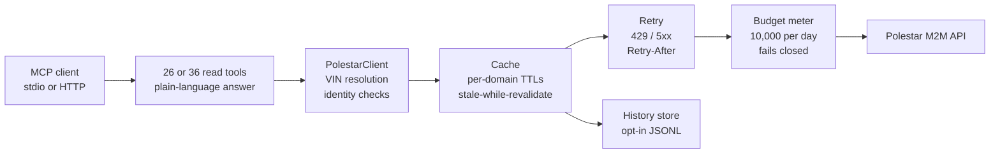

<div align="center">

# polestar-mcp

Read-only MCP server for the Polestar Data Portal machine-to-machine (M2M) API. Ask about your car in plain language and get answers from what the car reports.

A [Model Context Protocol](https://modelcontextprotocol.io) server for the [Polestar Data Portal](https://data-portal.polestar.com), for clients such as Claude Desktop or Cursor, or your own.


</div>

polestar-mcp is a personal project for one owner's Polestar 2. It is not affiliated with or endorsed by Polestar. The package is not published to npm or the MCP Registry yet, so run it from a clone.

## What it does

The server connects an MCP client to the Polestar Data Portal. Ask "how is my car doing?" and the assistant calls one tool and returns a short briefing: charge, range, locks, availability, odometer, service countdown, and how old each value is. Charging questions work the same way, from a time-to-target estimate to a cheapest-hours plan built from spot prices you supply.

The API is read-only, and so is this server. Every network call a tool makes is a GET; the only POST is the OAuth token request. Polestar's documented v1 API publishes no write endpoints, so nothing here can lock the car, start the climate, or change a charge limit. Every tool declares `readOnlyHint` and `idempotentHint`, and tools that reach the API also set `openWorldHint`. Clients that honour those hints may run reads without asking; clients that ignore them still show a confirmation.

A default start exposes 26 tools. Setting `POLESTAR_HISTORY_DIR` adds ten history tools and raises the surface to 36. The extra tools answer questions the API cannot, such as how the battery has aged, what a charging session cost, and what changed this week.

## Contents

- [What it does](#what-it-does)
- [Requirements](#requirements)
- [Quick start](#quick-start)
  - [Get the code](#get-the-code)
  - [Try it with sample data](#try-it-with-sample-data)
  - [Connect your car](#connect-your-car)
  - [Check it works](#check-it-works)
- [Troubleshooting](#troubleshooting)
- [What you can ask](#what-you-can-ask)
- [The tools](#the-tools)
- [History and privacy](#history-and-privacy)
- [Configuration](#configuration)
- [Rate limits, caching, and tokens](#rate-limits-caching-and-tokens)
- [Resources, prompts, and subscriptions](#resources-prompts-and-subscriptions)
- [Run it over HTTP](#run-it-over-http)
- [Development and testing](#development-and-testing)
- [Contributing](#contributing)
- [Security](#security)
- [Documentation](#documentation)
- [Project status](#project-status)
- [License](#license)

## Requirements

- Node.js 20.11 or newer, with git and npm.
- An MCP client that can launch a local process over stdio, the transport a client uses to start a server as a child process.
- A Polestar Data Portal credential for live mode: client ID, client secret, and Account ID. The sample-data path needs none of them.
- macOS, Linux, or Windows. The credential recipe below is POSIX shell; on Windows, create the same file with an editor.
- A clone of this repository. The package is not on npm yet, so `npm ci` outside a clone will fail.

## Quick start

### Get the code

```sh
git clone https://github.com/nicolaskheirallah/polestar-mcp.git
cd polestar-mcp
npm ci
npm run build
```

`npm ci` installs the locked dependencies and `npm run build` writes `build/server.js`, the file an MCP client launches. `npm start` runs the same file directly.

### Try it with sample data

The repository ships a sanitized capture of API responses under `test/fixtures/dump`. Fixture mode replays that capture through the full server, including the token flow, and never reads a secrets file or contacts Polestar.

```sh
npm run demo
```

The demo prints `DUMP_OK` when every assertion passes. To ask questions against the sample data, register the server in your client with the fixture directory. This is the same `mcpServers` block as the live setup below, with one extra `env` entry:

```json
{
  "mcpServers": {
    "polestar-sample": {
      "command": "node",
      "args": ["/absolute/path/to/polestar-mcp/build/server.js"],
      "env": {
        "POLESTAR_FIXTURES_DIR": "/absolute/path/to/polestar-mcp/test/fixtures/dump"
      }
    }
  }
}
```

Restart the client and ask "how is my car doing?". `npm start` on its own starts a stdio server that waits for a client, so it is not a web page; the client configuration is what connects them. Fixture mode runs the real authentication lifecycle, so a capture without a token response fails with `AuthError: Token request failed (HTTP 404)` rather than skipping auth. A route with no fixture answers `NOT_FOUND`, which is deliberately different from `DATA_NOT_AVAILABLE`: a missing fixture cannot pass as a car that reports nothing.

### Connect your car

1. Log in at [data-portal.polestar.com](https://data-portal.polestar.com), open the Data Portal API tab, and create a credential. The portal gives you three values: the OAuth client ID, the client secret (shown once), and the Account ID (`x-client-id`). The Account ID is not the client ID. The client ID authenticates the token request; the Account ID identifies you on every vehicle request. Using the client ID as the Account ID makes every call fail with `403 AUTHZ_CLIENT_ID_MISMATCH`, and the server warns at startup when the two match.

2. Store the values outside any repository:

   ```sh
   mkdir -p ~/.config/polestar-mcp
   cat > ~/.config/polestar-mcp/.env.secrets <<'EOF'
   POLESTAR_CLIENT_ID=paste-your-client-id-here
   POLESTAR_CLIENT_SECRET=paste-your-client-secret-here
   POLESTAR_ACCOUNT_ID=paste-your-account-id-here
   EOF
   ```

   On Windows, create `%USERPROFILE%\.config\polestar-mcp\.env.secrets` in an editor with the same three lines. [`.env.example`](.env.example) lists every variable as a template.

3. Register the server in your MCP client:

   ```json
   {
     "mcpServers": {
       "polestar": {
         "command": "node",
         "args": ["/absolute/path/to/polestar-mcp/build/server.js"]
       }
     }
   }
   ```

   Claude Desktop reads `claude_desktop_config.json`; other clients expose MCP servers in their settings and many accept the same `mcpServers` shape. Use the absolute path to `build/server.js`, and the absolute path to your Node executable if the client cannot find `node` on its PATH.

4. Restart the client.

<details>
<summary>Put the credentials in the client's env block instead</summary>

Real environment variables win over the secrets file, so either source works:

```json
{
  "mcpServers": {
    "polestar": {
      "command": "node",
      "args": ["/absolute/path/to/polestar-mcp/build/server.js"],
      "env": {
        "POLESTAR_CLIENT_ID": "<client id>",
        "POLESTAR_CLIENT_SECRET": "<client secret>",
        "POLESTAR_ACCOUNT_ID": "<account id, not the client id>"
      }
    }
  }
}
```

</details>

What the client supports changes the experience:

| Client capability | Effect |
| --- | --- |
| Launches a stdio process | The full surface, including resource subscriptions |
| Speaks Streamable HTTP | The same tools, resources, and prompts, but no subscriptions |
| Supports MCP prompts | Sees `car-status` and `charge-plan`, plus `battery-health-report` with history enabled |
| Honours `readOnlyHint` | May run reads without confirmation; clients that ignore hints still ask |
| Supports MCP elicitation or the 2026 input flow | Several cars trigger a "which car" question; without it the call returns `AMBIGUOUS_VIN` with the known VINs |

The server writes diagnostics to stderr; stdout carries the MCP protocol. If the client never shows the server, the reason is in the client's MCP log, not in the chat.

### Check it works

Run the two checks that do not need a client or a car:

```sh
node build/server.js --version   # 0.3.0
npm run demo                     # DUMP_OK
```

Then ask the client for `polestar_status`. In live mode it reports the budget used, the cache state, and the token expiry; `get_car_status` answers with a data age. On startup the server writes a line like `live · v0.3.0 · budget 10000/day · cache on · history off` and `ready: 26 tools over 15 domains` to stderr. If nothing works, start with [Troubleshooting](#troubleshooting).

## Troubleshooting

| What you see | What it means | What to do |
| --- | --- | --- |
| The client shows no polestar server | The client could not start `build/server.js` | Run `npm run build`, check the absolute path and that the client can find `node`, then read the client's MCP log; diagnostics go to stderr |
| `Missing environment variables: ...` | No secrets file and no client `env` block | Create the secrets file, or fill the `env` block; `POLESTAR_ACCOUNT_ID` is required too |
| `403 AUTHZ_CLIENT_ID_MISMATCH` on every call | `POLESTAR_ACCOUNT_ID` holds the OAuth client ID | Use the Account ID shown next to the Base URL in the Data Portal |
| `AuthError: Token request failed (HTTP 401)` | The client ID or secret is wrong | Re-create the credential and update the secrets file |
| `AuthError: Token request failed (HTTP 404)` | Wrong base URL, or a fixture dump without a token response | Check `POLESTAR_BASE_URL`; in fixture mode add `token.json` to the dump |
| `Daily API budget exhausted: ...` | The 10,000 calls/day ceiling was reached | Wait for the midnight UTC reset, or raise `POLESTAR_BUDGET` only if your allowance differs |
| `AMBIGUOUS_VIN` | Several cars and no `vin` argument | Call `list_vehicles` and pass an explicit VIN |
| `Refusing to serve on ... without POLESTAR_HTTP_TOKEN` | HTTP mode on a non-loopback address without a bearer token | Bind `127.0.0.1`, or set a token of at least 16 characters |
| A tool answers "No ... data is available" | The car does not report that topic | This is a normal answer, not a failure |

`node build/server.js --version` and `--help` exit before the protocol starts and prove the build and Node version. `POLESTAR_LOG=debug` adds verbose stderr. The full table, including invalid configuration and fixture `NOT_FOUND`, is in [getting started](docs/getting-started.md#troubleshooting).

## What you can ask

| You ask | The assistant calls | You get |
| --- | --- | --- |
| "How is my car doing?" | `get_car_status` | A short briefing: charge, range, locks, availability, odometer, service, data ages |
| "Is everything locked?" | `is_car_secure` | A yes/no verdict that names anything open |
| "Does anything need attention?" | `get_needs_attention` | Active warnings only, plus the service countdown |
| "When will it be charged?" | `get_charging_estimate` | Energy and time to target, with assumptions stated |
| "Plan the cheapest charging tonight" | `plan_cheapest_charge` | A schedule of hours from a spot-price curve you supply |
| "Where is the car?" | `get_location` | Last known position with heading, speed, and data age |
| "How has the battery aged?" | `get_degradation_report` | Capacity and range trends (needs history) |
| "What is my charging setup?" | `get_charging_setup` | The seven charging settings in one answer, each with its age |
| "Will the car be ready by Sunday at 14:00?" | `get_departure_readiness` | Yes or no with the charge deadline, or a refusal when the timer cannot support it |
| "What did charging cost me?" | `get_charging_cost` | Energy, cost and assumptions per recorded session (needs history) |
| "What did I drive this week?" | `get_trips` | Trips rebuilt from odometer history, gaps and resets named (needs history) |
| "Catch me up on the week" | `get_weekly_digest` | Distance, charge, warnings and settings changes in one answer (needs history) |

```text
Vehicle My Car, telemetry/battery (data observed 12 min ago)
Charge: 52% · range 170 km
Charging: Idle · Unplugged
Average consumption: 20.1 kWh/100km
```

The vehicle label comes from `POLESTAR_VEHICLE_LABELS`; without one the header shows the VIN, masked when `POLESTAR_REDACT_VIN=1`. The values match the sample data, and the age is illustrative. Domain tools answer in short prose. Passing `raw: true` appends the untouched API payload. A successful result carries that text plus structured data where the tool has one; failures use `structuredContent.message`.

## The tools

One domain is one topic of vehicle data, such as `telemetry/battery`. The 15 `get_*` tools in the Telemetry and Charging groups map one-to-one onto the API's 15 read domains: 8 telemetry, 7 charging. The aggregate, planning, system, and history tools build on those reads or answer from local state.

Every tool that reads a car takes an optional `vin`, the vehicle identification number. Omit it when the credential sees one vehicle. With several, the server asks the client which car when the client supports MCP elicitation or the 2026 input flow, validates the answer, and otherwise refuses with `AMBIGUOUS_VIN` and the known VINs so you can pass one explicitly. Argument names are strict; a misspelled `vin` is refused by name instead of quietly reading the default car. Third-party credentials can pass `delegated_account_id`, which is checked against the operator's allowlist because the API accepts unknown delegated IDs without complaint.

A default start exposes 26 tools: 15 domain tools, 7 aggregate and planning tools, `list_vehicles`, `list_domains`, `list_vehicle_domains`, and `polestar_status`. With `POLESTAR_HISTORY_DIR` set, ten history tools join and the surface is 36.

<details>
<summary>All 36 tools, grouped</summary>

| Tool | What it answers |
| --- | --- |
| **Discovery** | |
| `list_vehicles` | VINs, or your friendly names, that this credential may access |
| `list_domains` | The server's own registry: every domain with endpoint, scope, and tool name |
| `list_vehicle_domains` | Which of the 15 domains this car reports, which are absent or refused, with data ages |
| **Telemetry** | |
| `get_availability` | Whether the car is reachable or awake, and its usage mode |
| `get_battery` | Charge level, charging status and power, range, time to full, consumption, usable energy |
| `get_exterior` | Doors, windows, hood, tailgate, tank lid, central lock, tailgate lock, alarm |
| `get_health` | Service countdown (days, distance, engine hours) and fluid, light, and 12V warnings |
| `get_location` | Last known position, heading, speed, timestamp |
| `get_odometer` | Odometer and trip meters, average speeds |
| `get_parking_climatization` | Preheat or pre-cool status, runtime left, requested seat and wheel heating |
| `get_pre_cleaning` | Cabin air: PM2.5, air quality index, last pre-cleaning cycle |
| **Charging** | |
| `get_amp_limit` | Configured maximum AC charging current, source, last update |
| `get_charge_locations` | Charge-location settings, often without addresses |
| `get_charge_now` | Charge-now override state and timer sync |
| `get_global_charge_timer` | Recurring charge window: hours, timezone offset, activation, sync |
| `get_parking_climate_timer` | Scheduled climate timers: ready-at hour, weekdays, activation |
| `get_target_soc` | Target charge level and setting type |
| `get_is_at_charge_location` | Whether the car is at a saved charge location, often unreported |
| **Aggregates and planning** | |
| `get_car_status` | The briefing in one call: several domains at once, each value aged |
| `is_car_secure` | Yes/no security verdict that names anything open |
| `get_needs_attention` | Active warnings only |
| `get_charging_estimate` | Energy and time to target, assumptions shown |
| `get_charging_setup` | All seven settings at once, each aged |
| `plan_cheapest_charge` | Cheapest hours inside the car's charge window, given your spot prices |
| `get_departure_readiness` | Whether the car can be charged and preconditioned by a departure time |
| **System** | |
| `polestar_status` | Budget used and remaining with reset time, cache hit rate, token expiry, mode |
| **History** (opt-in) | |
| `get_history` | Recorded samples for one domain, one line per change |
| `get_degradation_report` | Implied full-charge range and capacity trend over history, with a 95% interval once the span allows it |
| `get_charging_sessions` | Charging sessions reconstructed from battery samples |
| `get_charging_cost` | Energy and cost of each recorded session, assumptions and missing prices named |
| `get_warning_changes` | Warnings that appeared or cleared between recorded health samples |
| `get_service_forecast` | Which service limit arrives first, from the car's countdown and your odometer rate |
| `get_settings_history` | Recorded changes to charging settings, dated by the value clock |
| `get_trips` | Trips reconstructed from odometer history, gaps and resets named |
| `get_timeline` | Cross-domain timeline of what changed, over a window of hours |
| `get_weekly_digest` | One seven-day digest: distance, charge, warnings, settings |

</details>

`list_domains` prints the endpoint and OAuth scope for every domain; [docs/tools-reference.md](docs/tools-reference.md) has the full mapping, scopes, and worked examples.

## History and privacy

The API reports current state only, so questions about the past need a local store. Set `POLESTAR_HISTORY_DIR` and the server appends each live domain answer to a JSONL file, one JSON object per line, under that directory. The layout is one subdirectory per vehicle, named by VIN, and one `<kind>-<domain>.jsonl` file per domain. Deduplication is by the cloud's change ID (`metaEventId`): an unchanged snapshot is not appended, so a file grows only when the car reports a change. When a file would pass 64 MiB, it is rewritten with its newest half, so an unattended install does not grow without bound. Position is recorded only when location reads are allowed, and deleting the directory removes the history. Recording is passive: it reuses answers the server already fetched. To sample while nobody is asking, set `POLESTAR_SAMPLE=1`; the sampler covers battery, odometer, location, and exterior every 10 minutes by default and pauses at 80 percent of the budget. It requires `POLESTAR_HISTORY_DIR`.

Credentials stay on the machine, requests go only to Polestar, and the server sends no telemetry. The history store is opt-in. The full policy is in [docs/privacy.md](docs/privacy.md).

These variables control what leaves the car and how answers label it:

| Variable | Effect |
| --- | --- |
| `POLESTAR_VEHICLE_LABELS` | `VIN=Friendly Name` pairs, so answers say "My Car" instead of printing identifiers |
| `POLESTAR_REDACT_VIN=1` | Masks VINs in tool text, the structured envelope, resource names, descriptions and bodies, completions, prompt text, and error text. Three documented exceptions: `raw:true` returns the upstream payload, the resource URI keeps the VIN so resources stay readable and subscribable, and the on-disk history paths are named by VIN and never leave the machine |
| `POLESTAR_ALLOW_LOCATION=0` | `get_location` refuses, coordinates are stripped from aggregates, the location resource is refused, and recorded position history is refused |

Resource URIs are the one client-visible surface redaction does not cover. If a transcript must not carry the VIN, do not enable resource listing for that client. History files are created `0600` and per-vehicle directories `0700`.

## Configuration

All configuration is environment-only. Most installs set only the three credentials; everything else has a default. [`.env.example`](.env.example) lists every name as a template. The server warns about unrecognized variables and suggests the closest real name; with `POLESTAR_STRICT_ENV=1` a typo is fatal. A value that is present but unusable, such as a bad URL, a non-numeric timeout, or an out-of-range port, fails fast with the fix in the message.

<details>
<summary>Full configuration reference (29 variables)</summary>

| Variable | Default | Purpose |
| --- | --- | --- |
| `POLESTAR_CLIENT_ID` | required live | OAuth client ID from the Data Portal |
| `POLESTAR_CLIENT_SECRET` | required live | OAuth client secret |
| `POLESTAR_ACCOUNT_ID` | required live | The Account ID, sent as `x-client-id` (distinct from the client ID) |
| `POLESTAR_DELEGATED_ACCOUNT_ID` | unset | Default delegated account for third-party credentials |
| `POLESTAR_DELEGATED_ACCOUNT_IDS` | unset | Allowlist a call's `delegated_account_id` argument is checked against |
| `POLESTAR_BASE_URL` | production URL | Override the API base URL |
| `POLESTAR_M2M_TOKEN_ENDPOINT` | `{base}/token` | Override just the token endpoint |
| `POLESTAR_FIXTURES_DIR` | unset | Serve captured responses instead of the live API |
| `POLESTAR_ENV_FILE` | unset | Alternative dotenv path (default `~/.config/polestar-mcp/.env.secrets`) |
| `POLESTAR_TIMEOUT_MS` | 15000 | Hard deadline per HTTP request |
| `POLESTAR_BUDGET` | 10000 | Daily live-call ceiling; fails closed at the limit |
| `POLESTAR_BUDGET_PER_MINUTE` | 100 | Rolling per-minute ceiling; waited out rather than failed when the wait fits the deadline |
| `POLESTAR_BUDGET_LEDGER` | unset | Absolute path to a JSON file that keeps the daily call count across restarts and processes |
| `POLESTAR_CACHE` | on | `off` disables the response cache |
| `POLESTAR_SCOPES` | all domain scopes | Space- or comma-separated scope override for the token request |
| `POLESTAR_HISTORY_DIR` | unset | Enable the JSONL history store and the history tools here |
| `POLESTAR_HISTORY_SAMPLE_SECONDS` | 600 | Seconds between sampler rounds (clamped 60 to 3600) |
| `POLESTAR_SAMPLE` | off | `1` runs the background sampler (needs `POLESTAR_HISTORY_DIR`); polling spends quota |
| `POLESTAR_VEHICLE_LABELS` | unset | `VIN=Name` pairs shown instead of VINs |
| `POLESTAR_REDACT_VIN` | off | `1` masks VINs in answers. Exceptions: `raw:true`, resource URIs, on-disk history paths |
| `POLESTAR_ALLOW_LOCATION` | on | `0` refuses location reads, strips coordinates, and refuses recorded position history |
| `POLESTAR_UNITS` | km | `mi` (or `miles`) for humanized distances |
| `POLESTAR_LOG` | normal | `debug` for verbose stderr diagnostics |
| `POLESTAR_ENABLE_WRITES` | off | Scaffold for future write endpoints; registers nothing today |
| `POLESTAR_HTTP_PORT` | 0 (stdio) | 1 to 65535 switches to Streamable HTTP |
| `POLESTAR_HTTP_HOST` | 127.0.0.1 | HTTP bind address |
| `POLESTAR_HTTP_TOKEN` | unset | Bearer token for HTTP mode; required off loopback and at least 16 characters |
| `POLESTAR_HTTP_ALLOWED_ORIGINS` | unset | Comma-separated absolute origins a browser client may call from; when set, the list replaces the default same-origin rule |
| `POLESTAR_STRICT_ENV` | off | `1` makes an unrecognized variable fatal |

</details>

## Rate limits, caching, and tokens

Polestar's M2M credential allows 10,000 calls per client per rolling UTC day and 100 per minute. The daily window resets at midnight UTC, and `polestar_status` reports `resetsAtUtc`. The token request and every retry attempt are metered against the same allowance, while cache hits and fixture reads are not.

A request travels client, tool, Polestar client, cache, retry, budget meter, API. The path is also drawn below; the sentence above is the fallback when the diagram does not render.



The cache lifetime (TTL) depends on how fast the value changes:

| Data | Cache lifetime |
| --- | --- |
| Battery, location, exterior | 30 seconds |
| Availability, odometer, parking climatization | 60 seconds |
| Charging settings: amp limit, target charge, timers, charge now, charge locations | 5 minutes |
| Health | 10 minutes |
| Pre-cleaning | 30 minutes |
| Vehicle list | 1 hour |

When an entry expires, the last value is served immediately, marked stale, while one shared refresh runs in the background.

Retries cover 429 responses (honouring `Retry-After`), 500, 502, 503, and 504, up to three attempts with capped backoff. A GET that fails on a network error gets one extra attempt. Every attempt is metered before it leaves.

The budget fails closed. When the daily allowance is gone, further calls are refused with the reset time instead of spending calls beyond the limit. The counter lives in memory by default; `POLESTAR_BUDGET_LEDGER` points it at a JSON file shared across restarts and processes. `polestar_status` reports budget, cache, and token state. The resource poller and sampler pause automatically at 90 percent and 80 percent of the budget so background work cannot consume the quota you need.

Tokens are cached. One token request covers the union of all domain scopes (trim it with `POLESTAR_SCOPES` for least privilege), and the token is reused until expiry minus a five-minute skew. Concurrent callers share one request, and a 401 triggers exactly one fresh-token retry.

## Resources, prompts, and subscriptions

The server exposes resources at `polestar://vehicle/{vin}/{telemetry|charging}/{domain}`. The list comes from the vehicles your credential can see, and the VIN and domain arguments support completions. Reading a resource returns the same plain-language view as the matching tool, and two resource templates are registered, one per kind.

Subscriptions need a client that supports `resources.subscribe` and a stdio session. The server re-reads a subscribed resource once a minute through the cache and notifies the client only when the cloud's `metaEventId` changes, which happens when the car reports something new. A session holds at most 50 subscriptions, and the poller pauses while 90 percent of the daily budget is spent. Over HTTP, `resources/subscribe` returns `-32601` and the handshake advertises `subscribe: false` instead of accepting a subscription that can never fire.

The server ships two prompts, `car-status` and `charge-plan`; `battery-health-report` joins when the history store is enabled. Each wires a common question to the right tool sequence. Nothing mutates, so clients that honour `readOnlyHint` may run these reads without asking.

## Run it over HTTP

Set a port and a token to serve the same engine over stateless Streamable HTTP:

```sh
POLESTAR_HTTP_PORT=8420 POLESTAR_HTTP_TOKEN=<at-least-16-characters> npm start
```

Each request is independent, while cache, budget, and history are shared. The listener binds `127.0.0.1` by default and prints its URL on stderr. A non-loopback bind requires `POLESTAR_HTTP_TOKEN` of at least 16 characters and is refused at startup otherwise. The listener speaks plain HTTP with no TLS of its own, so keep it on loopback or put it behind a proxy that terminates TLS and authenticates callers. The token is a shared secret, not per-user authentication: anyone who holds it can read every vehicle the credential can see.

Point an HTTP-capable client at `http://127.0.0.1:8420/mcp` and send `Authorization: Bearer <token>`; the root URL answers too. Browser cross-origin requests are refused unless the `Origin` matches the request host or appears in `POLESTAR_HTTP_ALLOWED_ORIGINS`. When that allowlist is unset, the request's own host is the default; when it is set, the list replaces that default. A forged `Host` is refused either way.

Both protocol eras are served from one listener. A 2025-era client gets the stateless legacy path; a `2026-07-28` client gets `server/discover` plus the per-request envelope, with the same 26-tool default surface, or 36 with history enabled. A modern request missing its envelope is refused by name, never silently downgraded. Resources and prompts work in both modes; subscriptions remain stdio only.

## Development and testing

```sh
npm ci
npm run build
npm run typecheck      # types src, test, and scripts together
npm test               # unit and integration suites
npm run coverage       # the same suite with the lines 90, branches 80, functions 85 floors
npm run demo           # offline demo against the shipped synthetic dump, prints DUMP_OK
```

The full check set, including `smoke`, `smoke-http`, `smoke-bin`, `demo-dump`, `verify-fixtures`, the secret and version gates, and the documentation gates, is in [CONTRIBUTING.md](CONTRIBUTING.md). CI runs it on every push and pull request, on Node 20.11, 22, and 24.

The suite covers the cases that are easy to get wrong here. Token single-flight, cache TTLs, envelope unwrapping, VIN resolution, retry and budget metering, and the configuration registry each have direct tests. So do the harder edges: expiry skew, identity checks, delegation, stale-while-revalidate, the charge-window planner including windows that wrap midnight, and history deduplication with session reconstruction.

## Contributing

Issues and pull requests are welcome. Read [CONTRIBUTING.md](CONTRIBUTING.md) before opening one: every behaviour claim needs a check, writing hygiene is enforced tree-wide, and a live capture must never be committed. Run `npm test` and `node docs/check-docs.mjs hygiene` before pushing.

## Security

The threat model is in [SECURITY.md](SECURITY.md). Credentials live outside the repository, at `~/.config/polestar-mcp/.env.secrets` or a path set with `POLESTAR_ENV_FILE`, and no `.env`-family file inside the tree is acceptable. `npm run check-secrets` scans the repository for JWTs, opaque credential blobs, VIN-shaped identifiers including ones embedded in longer tokens, personal email, phone numbers, and precise coordinates; it skips dependency and build directories and binary or image files. Each detector proves itself on a positive control before a clean scan counts.

> [!WARNING]
> Captured dumps are credentials. They contain long-lived refresh tokens and location history. Do not commit them, paste them into issues, or share them casually.

Failures carry the upstream `code`, `httpStatus`, and, when Polestar sent one, the `requestId` that support can look up. Quote the `requestId` in a report and do not paste the request body.

## Documentation

For users:

| Document | Contents |
| --- | --- |
| [Getting started](docs/getting-started.md) | Credentials, every variable explained, first calls, troubleshooting |
| [Tool reference](docs/tools-reference.md) | All 36 tools, with endpoints and scopes for the route-bound ones, and example responses |
| [Privacy policy](docs/privacy.md) | What is processed, where it goes, what stays local, and the owner's controls |

For developers and reviewers:

| Document | Contents |
| --- | --- |
| [Architecture](docs/architecture.md) | The client module, the cache/retry/budget chain, history, resources, HTTP mode |
| [The upstream API contract](docs/upstream-api.md) | Authentication, headers, envelope, errors, rate limits |
| [Live contract findings](docs/live-contract-findings.md) | What live probes settled about identity headers, VINs, domains, errors, and the token endpoint |
| [Development and verification](docs/development.md) | The test map, the CI checks, adding a tool |
| [Consumer API adapter note](docs/consumer-adapter-note.md) | Why the consumer app API stays unwired, and the shape when it lands |
| [Write endpoints](docs/write-endpoints.md) | The designed but dormant write surface and its safety rules |
| [Reviewer pack](docs/reviewer-pack.md) | Sample data, the example prompts, the directory checklist and the distribution status |
| [Claude Desktop bundle](docs/bundle.md) | The `.mcpb` manifest and the owner build checklist |

## Project status

The documented v1 API is read-only and this server is read-only with it. Polestar publishes no v1 write endpoints, so `POLESTAR_ENABLE_WRITES` registers nothing. The app-side consumer API, which would add car model details and render images, is deliberately not wired in: its GraphQL queries are unpublished and its refresh tokens rotate destructively, so depending on it would mean depending on a contract that can be revoked without notice.

Out of scope, deliberately:

- write or control endpoints of any kind
- a hosted service, backend, or project database
- user accounts or per-user authentication for HTTP mode
- a web or mobile interface
- webhooks or push notifications
- price fetching; prices are an argument to `plan_cheapest_charge`
- notifications over HTTP

The npm package and MCP Registry entry are prepared in this tree, and the release workflow checks, packs, and publishes on a version tag, but neither is published yet. Publishing is blocked on the owner's npm credentials and on npm name availability. The Claude Desktop `.mcpb` metadata exists in `mcpb/manifest.json`; building the bundle is blocked on the `mcpb` CLI and a desktop host to test it. Until those land, run the server from a clone with `npm ci && npm run build`.

polestar-mcp is a personal project for one owner's Polestar 2. It is not affiliated with or endorsed by Polestar.

## License

MIT. See [LICENSE](LICENSE).
