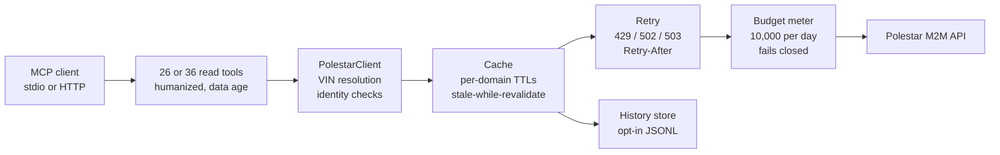

<div align="center">

# polestar-mcp

Read-only MCP server for the Polestar Data Portal M2M API.

A [Model Context Protocol](https://modelcontextprotocol.io) server for the [Polestar Data Portal M2M API](https://data-portal.polestar.com), built for any MCP client: Claude Desktop, ZCode, Cursor, or your own tooling.


</div>

## What it does

polestar-mcp connects an MCP client to the Polestar Data Portal, so you can ask about your car in plain language and get answers from the data the car reports. "How is my car doing?" becomes one tool call and one short briefing: charge, range, locks, availability, odometer, service countdown, and the age of each value.

The API is read-only, and so is this server. Every tool is a GET, and Polestar's documented v1 API publishes no write endpoints, so nothing here can lock the car, start the climate, or change a charge limit. Every tool carries `readOnlyHint: true`, so MCP clients can auto-approve calls.

A default start registers 26 tools. Enable the optional local history store and it registers 36. The extra ten answer questions the API cannot, such as how the battery has aged, what a charging session cost, which trips the odometer implies, and what changed this week.

## Contents

- [What it does](#what-it-does)
- [Requirements](#requirements)
- [Quick start](#quick-start)
- [What you can ask](#what-you-can-ask)
- [The tools](#the-tools)
- [Resources, prompts, and subscriptions](#resources-prompts-and-subscriptions)
- [Rate limits, caching, and tokens](#rate-limits-caching-and-tokens)
- [History and privacy](#history-and-privacy)
- [HTTP mode](#http-mode)
- [Configuration](#configuration)
- [Development and testing](#development-and-testing)
- [Security](#security)
- [Documentation](#documentation)
- [Project status](#project-status)
- [License](#license)

## Requirements

- Node.js 20.11 or newer.
- An MCP client that can launch a stdio server, such as Claude Desktop, ZCode, Cursor, or your own.
- A Polestar Data Portal credential: client ID, client secret, and Account ID. The offline demo does not need one.

## Quick start

### Try it without a car

The repository includes a sanitized capture of API responses under `test/fixtures/dump`. The demo runs the full server against that capture, token flow included:

```sh
npm ci
npm run build
npm run demo
```

`npm run demo` prints `DUMP_OK` when every assertion passes. To browse the same data interactively, start the server in fixture mode:

```sh
POLESTAR_FIXTURES_DIR=test/fixtures/dump npm start
```

Fixture mode uses the real authentication lifecycle, so a capture without a token response fails with `AuthError: Token request failed (HTTP 404)` rather than skipping auth. A route with no fixture answers `NOT_FOUND`, which is deliberately different from `DATA_NOT_AVAILABLE`: a missing fixture cannot be mistaken for a car that reports nothing.

### Connect your car

1. Log in at [data-portal.polestar.com](https://data-portal.polestar.com), open the Data Portal API tab, and create a credential. Note the client ID, the client secret (shown once), and the Account ID (`x-client-id`) at the top of the page.
2. Store them outside any repository, in the server's home config:

   ```sh
   mkdir -p ~/.config/polestar-mcp
   cat > ~/.config/polestar-mcp/.env.secrets <<'EOF'
   POLESTAR_CLIENT_ID=paste-your-client-id-here
   POLESTAR_CLIENT_SECRET=paste-your-client-secret-here
   POLESTAR_ACCOUNT_ID=paste-your-account-id-here
   EOF
   ```

3. Point your MCP client at the built server:

   ```json
   {
     "mcpServers": {
       "polestar": {
         "command": "node",
         "args": ["/absolute/path/to/polestar-mcp/build/server.js"]
       }
     }
   }
   ```

4. Restart the client.

One detail trips people up: the portal gives you two identifiers. The client ID authenticates the token request; the Account ID identifies you on every vehicle request. Using the client ID as the Account ID makes every call fail with `403 AUTHZ_CLIENT_ID_MISMATCH`. The server checks for this at startup and warns you.

Credentials can also ride in the client's `env` block instead of the secrets file. Real environment variables always win, and the dotenv loader handles `export` prefixes, both quote styles, and trailing comments.

### Check the connection

Ask the client for a status briefing. `get_car_status` is a good end-to-end check because it reads several domains and reports their ages. If something looks wrong, `polestar_status` shows the daily budget, cache state, and token expiry.

## What you can ask

| You ask | The assistant calls | You get |
| --- | --- | --- |
| "How is my car doing?" | `get_car_status` | One briefing: charge, range, locks, availability, odometer, service countdown, data ages |
| "Is everything locked?" | `is_car_secure` | A yes/no verdict that names anything open |
| "Does anything need attention?" | `get_needs_attention` | Active warnings only, plus the service countdown |
| "When will it be charged?" | `get_charging_estimate` | Energy and time to target, with every assumption stated |
| "Plan the cheapest charging tonight" | `plan_cheapest_charge` | A schedule of hours, given a spot-price curve you paste in |
| "Where is the car?" | `get_location` | Last known position with heading, speed, and data age |
| "How has the battery aged?" | `get_degradation_report` | Capacity and range trends (needs history, see below) |
| "What is my charging setup?" | `get_charging_setup` | The seven charging settings in one answer, each with its age |
| "Will the car be ready by Sunday at 14:00?" | `get_departure_readiness` | A yes or no with the charge deadline, or a refusal when the timer cannot support it |
| "What did charging cost me?" | `get_charging_cost` | Energy, cost and stated assumptions for each recorded charging session (needs history) |
| "What did I drive this week?" | `get_trips` | Trips rebuilt from odometer history, with gaps and resets named (needs history) |
| "Catch me up on the week" | `get_weekly_digest` | Distance, charge, warnings and settings changes in one answer (needs history) |

Domain tools answer in short prose. The header names the vehicle and domain and says how old the data is. Passing `raw: true` appends the untouched API payload. A successful result carries that text plus structured data where the tool has one; failures, not successes, use `structuredContent.message`.

```text
Vehicle My Car: telemetry/battery (data observed 12 min ago)
Charge: 52% · range 170 km
Charging: Idle · Unplugged
Average consumption: 20.1 kWh/100km
```

The example uses the project's sanitized fixtures. A live answer carries your own labels and numbers.

## The tools

Tool names follow the API domain names: `target-soc` becomes `get_target_soc`. Every tool that reads a car takes an optional `vin`. Omit it when the credential sees one vehicle; with several, the server asks which car through MCP elicitation and checks the answer before sending the request.

Argument names are strict. A misspelled `vin` is refused by name instead of quietly reading the default car. Third-party credentials can pass `delegated_account_id`, which is checked against the operator's allowlist because the API accepts unknown delegated IDs without complaint.

| Tool | What it answers |
| --- | --- |
| **Discovery** | |
| `list_vehicles` | VINs, or your friendly names, that this credential may access |
| `list_domains` | The server's own registry: every domain with endpoint, scope, and tool name |
| `list_vehicle_domains` | Which of the 15 domains this car reports, which are absent or refused, with data ages |
| **Telemetry** | |
| `get_availability` | Whether the car is reachable/awake, and its usage mode |
| `get_battery` | Charge level, charging status and power, range, time to full, consumption, usable energy |
| `get_exterior` | Doors, windows, hood, tailgate, tank lid, central lock, tailgate lock, alarm |
| `get_health` | Service countdown (days, distance, engine hours) and fluid, light, and 12V warnings |
| `get_location` | Last known position, heading, speed, timestamp |
| `get_odometer` | Odometer and trip meters, average speeds |
| `get_parking_climatization` | Preheat/pre-cool status, runtime left, requested seat and wheel heating |
| `get_pre_cleaning` | Cabin air: PM2.5, air quality index, last pre-cleaning cycle |
| **Charging** | |
| `get_amp_limit` | Configured maximum AC charging current, source, last update |
| `get_charge_locations` | Saved charge locations |
| `get_charge_now` | Charge-now override state (override charge timer sync) |
| `get_global_charge_timer` | Recurring charge window: hours, timezone offset, activation, sync |
| `get_parking_climate_timer` | Scheduled climate timers: ready-at hour, weekdays, activation |
| `get_target_soc` | Target charge level and setting type |
| `get_is_at_charge_location` | Whether the car is at a saved charge location (often unreported) |
| **Aggregates and planning** | |
| `get_car_status` | One-call briefing: charge, range, locks, availability, odometer, service, ages |
| `is_car_secure` | Yes/no security verdict that names anything open |
| `get_needs_attention` | Active health warnings only, plus the service countdown |
| `get_charging_estimate` | Energy and time to reach the target SoC, assumptions stated |
| `get_charging_setup` | The seven charging settings in one call, each with its data age |
| `plan_cheapest_charge` | Cheapest hours inside the car's charge window, given your spot prices |
| `get_departure_readiness` | Whether the car can be charged and preconditioned by a departure time |
| **System** | |
| `polestar_status` | Budget used and remaining with reset time, cache hit rate, token expiry, mode |
| **History** (opt-in) | |
| `get_history` | Recorded samples for one domain, one line per change |
| `get_degradation_report` | Implied full-charge range and capacity trend over history, with a 95% interval once the span allows it |
| `get_charging_sessions` | Charging sessions reconstructed from battery samples |
| `get_charging_cost` | Energy and cost of each recorded session, assumptions and missing prices named |
| `get_warning_changes` | Warnings that appeared or cleared between recorded health samples |
| `get_service_forecast` | Which service limit arrives first, from the car's countdown and your odometer rate |
| `get_settings_history` | Recorded changes to charging settings, dated by the value clock |
| `get_trips` | Trips reconstructed from odometer history, gaps and resets named |
| `get_timeline` | Cross-domain timeline of what changed, over a window of hours |
| `get_weekly_digest` | One seven-day digest: distance, charge, warnings, settings |

The 15 `get_*` domain tools map one-to-one onto the API's 15 read domains: eight telemetry, seven charging. `list_vehicle_domains` answers the car-level question of which domains this vehicle reports. `list_domains` prints the endpoint and OAuth scope for every domain; the full mapping, scopes, and worked examples are in [docs/tools-reference.md](docs/tools-reference.md).

## Resources, prompts, and subscriptions

Resources are exposed at `polestar://vehicle/{vin}/{telemetry|charging}/{domain}`. The list comes from the vehicles your credential can see, and the VIN and domain arguments support completions. Reading a resource returns the same humanized view as the matching tool.

Subscriptions are available over stdio. The server re-reads a subscribed resource once a minute through the cache and notifies the client only when the cloud's `metaEventId` changes, which happens when the car reports something new. The poller pauses rather than spending the last 10 percent of the daily budget.

Two prompts are registered on a default start, `car-status` and `charge-plan`. `battery-health-report` joins when the history store is enabled. Each wires a common question to the right tool sequence. Nothing mutates, so clients can skip confirmation prompts.

## Rate limits, caching, and tokens

Polestar's M2M credential allows 10,000 calls per client per day, about seven per minute sustained. The server treats the daily allowance as a budget.



Caching carries most repeat traffic. Each URL gets a TTL matched to how fast the value changes: 30 seconds for battery, location, and exterior; 60 seconds for availability, odometer, and parking climatization; 5 minutes for charging settings; 10 minutes for health; 30 minutes for pre-cleaning; 1 hour for the vehicle list. When an entry expires, the cached value is served immediately, marked stale, while a single-flight refresh runs in the background.

Retries are limited. 429 responses (with `Retry-After` when present) and 502/503 gateway errors get up to three attempts with capped backoff. Every attempt is metered before it leaves.

The budget fails closed. When the daily allowance is gone, further calls are refused with the reset time instead of spending calls beyond the limit. The counter is held in memory by default; `POLESTAR_BUDGET_LEDGER` points it at a JSON file shared across restarts and processes. `polestar_status` reports budget, cache, and token state, and the resource poller and sampler pause automatically at 90 percent and 80 percent of the budget so background work cannot consume the quota you need.

Tokens are cached. One token request covers the union of all domain scopes (trim it with `POLESTAR_SCOPES` for least privilege), and the token is reused until expiry minus a five-minute skew. Concurrent callers share one request, and a 401 triggers exactly one fresh-token retry.

## History and privacy

The API reports current state only, so questions about the past need a local store. Set `POLESTAR_HISTORY_DIR` and each live domain answer is appended to a JSONL file, deduplicated by `metaEventId`; an unchanged snapshot costs one line. The store feeds `get_history`, the degradation report, charging sessions, and the other history tools. Recording is passive: it reuses answers the server already fetched. To sample while nobody is asking, set `POLESTAR_SAMPLE=1`. The sampler covers battery, odometer, location, and exterior every 10 minutes by default and stops at 80 percent of the budget.

These variables control what leaves the car and how it is named:

| Variable | Effect |
| --- | --- |
| `POLESTAR_VEHICLE_LABELS` | `VIN=Friendly Name` pairs, so answers say "My Car" instead of printing identifiers |
| `POLESTAR_REDACT_VIN=1` | Masks VINs in rendered output (first 3 and last 3 characters). Not with `raw:true`, which returns the payload as sent |
| `POLESTAR_ALLOW_LOCATION=0` | `get_location` refuses, coordinates are stripped from aggregates, and recorded position history is refused |

The store is owner-only: files are created `0600` and per-vehicle directories `0700`. Position history is refused in `get_history` when `POLESTAR_ALLOW_LOCATION=0`, matching every other location surface.

## HTTP mode

Set `POLESTAR_HTTP_PORT=8420 npm start` and the same engine serves tools, resources, and prompts over stateless Streamable HTTP. Each request is independent, while cache, budget, and history are shared. It binds `127.0.0.1` by default; binding any other address requires `POLESTAR_HTTP_TOKEN`, because a server that reads vehicle location must not sit unauthenticated on a shared network. Browser cross-origin requests are refused unless the `Origin` matches the request host or appears in `POLESTAR_HTTP_ALLOWED_ORIGINS`; a forged `Host` is refused the same way.

Resources work in both modes. Subscriptions do not: a stateless request's surface is closed as its response ends, so a poller would be stopped before its first tick. The server answers `resources/subscribe` with an error and advertises `subscribe: false` in the handshake instead of accepting a subscription that can never fire. Use stdio for subscriptions.

Both protocol eras are served from one listener. A 2025-era client gets the stateless legacy path; a `2026-07-28` client gets `server/discover` plus the per-request envelope, with the same 26-tool default surface, or 36 with history enabled. A modern request missing its envelope is refused by name, never silently downgraded to the legacy path.

## Configuration

All configuration is environment-only. The server knows which variables it reads and warns about unrecognized ones, suggesting the closest real name; with `POLESTAR_STRICT_ENV=1` a typo is fatal. A value that is present but unusable, such as a bad URL, a non-numeric timeout, or an out-of-range port, fails fast with the fix in the message.

<details>
<summary>Full configuration reference (29 variables)</summary>

| Variable | Default | Purpose |
| --- | --- | --- |
| `POLESTAR_CLIENT_ID` | required live | OAuth client ID from the Data Portal |
| `POLESTAR_CLIENT_SECRET` | required live | OAuth client secret |
| `POLESTAR_ACCOUNT_ID` | required live | The Account ID, sent as `x-client-id` (distinct from the client ID) |
| `POLESTAR_DELEGATED_ACCOUNT_ID` | unset | Default delegated account for third-party credentials |
| `POLESTAR_DELEGATED_ACCOUNT_IDS` | unset | Allowlist a call's `delegated_account_id` argument is checked against |
| `POLESTAR_BASE_URL` | production URL | Override the API base URL |
| `POLESTAR_M2M_TOKEN_ENDPOINT` | `{base}/token` | Override just the token endpoint |
| `POLESTAR_FIXTURES_DIR` | unset | Serve captured responses instead of the live API |
| `POLESTAR_ENV_FILE` | unset | Alternative dotenv path (default `~/.config/polestar-mcp/.env.secrets`) |
| `POLESTAR_TIMEOUT_MS` | 15000 | Hard deadline per HTTP request |
| `POLESTAR_BUDGET` | 10000 | Daily live-call ceiling; fails closed at the limit |
| `POLESTAR_BUDGET_PER_MINUTE` | 100 | Rolling per-minute ceiling the API also publishes; waited out rather than failed, when the wait fits the deadline |
| `POLESTAR_BUDGET_LEDGER` | unset | Absolute path to a JSON file that keeps the daily call count across restarts and processes; unset keeps the meter in memory |
| `POLESTAR_CACHE` | on | `off` disables the response cache |
| `POLESTAR_SCOPES` | all domain scopes | Space- or comma-separated scope override for the token request |
| `POLESTAR_HISTORY_DIR` | unset | Enable the JSONL history store (and history tools) here |
| `POLESTAR_HISTORY_SAMPLE_SECONDS` | 600 | Seconds between sampler rounds (clamped 60 to 3600) |
| `POLESTAR_SAMPLE` | off | `1` actually runs the background sampler; off by default, polling spends quota |
| `POLESTAR_VEHICLE_LABELS` | unset | `VIN=Name` pairs shown instead of VINs |
| `POLESTAR_REDACT_VIN` | off | `1` masks VINs in rendered output and the structured envelope. `raw:true` is exempt: it returns the upstream payload unchanged, VIN included |
| `POLESTAR_ALLOW_LOCATION` | on | `0` refuses location reads and strips coordinates |
| `POLESTAR_UNITS` | km | `mi` (or `miles`) for humanized distances |
| `POLESTAR_LOG` | normal | `debug` for verbose stderr diagnostics |
| `POLESTAR_ENABLE_WRITES` | off | Scaffold for future write endpoints; registers nothing today |
| `POLESTAR_HTTP_PORT` | 0 (stdio) | 1 to 65535 switches to Streamable HTTP |
| `POLESTAR_HTTP_HOST` | 127.0.0.1 | HTTP bind address |
| `POLESTAR_HTTP_TOKEN` | unset | Bearer token for HTTP mode; required off loopback |
| `POLESTAR_HTTP_ALLOWED_ORIGINS` | unset | Comma-separated absolute origins a browser client may call from; unset allows the request's own Host only |
| `POLESTAR_STRICT_ENV` | off | `1` makes an unrecognized variable fatal |

</details>

## Development and testing

```sh
npm ci
npm run typecheck      # types src, test, and scripts together
npm run build          # strict TypeScript, emits build/server.js
npm test               # unit and integration suites
npm run coverage       # the same suite with the lines 90, branches 80, functions 85 floors
npm run smoke          # stdio end to end: registry, tools, resources, prompts, history
npm run smoke-http     # Streamable HTTP end to end over plain POSTs
npm run smoke-bin      # the published bin path: --version, --help, handshake
npm run demo           # offline demo against the shipped synthetic dump, prints DUMP_OK
npm run demo-dump      # contributor demo; set POLESTAR_FIXTURES_DIR for a real capture
npm run verify-fixtures  # every domain has a valid Envelope fixture
npm run check-secrets  # credential, VIN, email, phone and coordinate scan
npm run check-tool-refs  # prose never names a tool the registry lacks
npm run check-version  # one version across the six documented locations
npm run check-server-json  # MCP Registry metadata shape
node docs/check-docs.mjs <tools|envvars|links|hygiene>  # documentation gates
```

The suite runs on Node 20.11, 22, and 24 in CI. The suite covers the cases that are easy to get wrong in this server: token single-flight and expiry skew, envelope unwrapping and identity checks, VIN resolution and delegation, cache TTLs and stale-while-revalidate, retry and budget metering, the charge-window planner including windows that wrap midnight, history dedup and session reconstruction, and the configuration registry.

Every check runs on each push and pull request. [CONTRIBUTING.md](CONTRIBUTING.md) carries the table with what each check proves, and describes how to add a domain or a tool. The architecture is in [docs/architecture.md](docs/architecture.md) and [docs/development.md](docs/development.md).

## Security

The threat model is in [SECURITY.md](SECURITY.md). Credentials live outside the repository, at `~/.config/polestar-mcp/.env.secrets` or a path set with `POLESTAR_ENV_FILE`. No `.env`-family file inside the tree is acceptable. `npm run check-secrets` scans every file for JWTs, opaque credential blobs, VIN-shaped identifiers including ones embedded in longer tokens, personal email, phone numbers, and precise coordinates. Each detector proves itself on a positive control before a clean scan counts.

> [!WARNING]
> Captured dumps are credentials. They contain long-lived refresh tokens and location history. Do not commit them, paste them into issues, or share them casually.

Every API error preserves the `requestId` and `timestamp` Polestar support can look up.

## Documentation

| Document | Contents |
| --- | --- |
| [Getting started](docs/getting-started.md) | Credentials, every variable explained, first calls, troubleshooting |
| [Tool reference](docs/tools-reference.md) | All 36 tools, endpoints and scopes, example responses |
| [Architecture](docs/architecture.md) | The client module, the cache/retry/budget chain, history, resources, HTTP mode |
| [The upstream API contract](docs/upstream-api.md) | Authentication, headers, envelope, errors, rate limits |
| [Live contract findings](docs/live-contract-findings.md) | What live probes settled about identity headers, VINs, domains, errors, and the token endpoint |
| [Development and verification](docs/development.md) | The test map, the CI checks, adding a tool |
| [Consumer API adapter note](docs/consumer-adapter-note.md) | Why the consumer app API stays unwired, and the shape when it lands |
| [Write endpoints](docs/write-endpoints.md) | The designed but dormant write surface and its safety rules |
| [Privacy policy](docs/privacy.md) | What is processed, where it goes, what stays local, and the owner's controls |
| [Reviewer pack](docs/reviewer-pack.md) | Sample data, the example prompts, the directory checklist and the distribution status |
| [Claude Desktop bundle](docs/bundle.md) | The `.mcpb` manifest and the owner build checklist; the bundle build is blocked on the CLI and a desktop host |

## Project status

The documented v1 API is read-only and this server is read-only with it. Polestar publishes no v1 write endpoints, so `POLESTAR_ENABLE_WRITES` registers nothing. The app-side consumer API, which would add car model details and render images, is deliberately not wired in: its GraphQL queries are unpublished and its refresh tokens rotate destructively, so depending on it would mean depending on a contract that can be revoked without notice.

The npm package and MCP Registry entry are prepared in this tree, and the release workflow checks, packs, and publishes on a version tag, but neither is published yet. Publishing is blocked on the owner's npm credentials and on npm name availability. The Claude Desktop `.mcpb` metadata exists in `mcpb/manifest.json`; building the bundle is blocked on the `mcpb` CLI and a desktop host to test it. Until those land, run the server from a clone with `npm ci && npm run build`. Directory reviewers should start with [docs/reviewer-pack.md](docs/reviewer-pack.md); data handling is described in [docs/privacy.md](docs/privacy.md).

polestar-mcp is a personal project for one owner's Polestar 2. It is not affiliated with or endorsed by Polestar.

## License

MIT. See [LICENSE](LICENSE).
